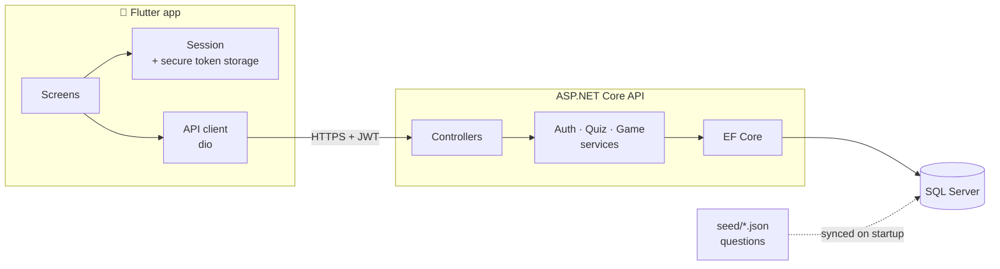
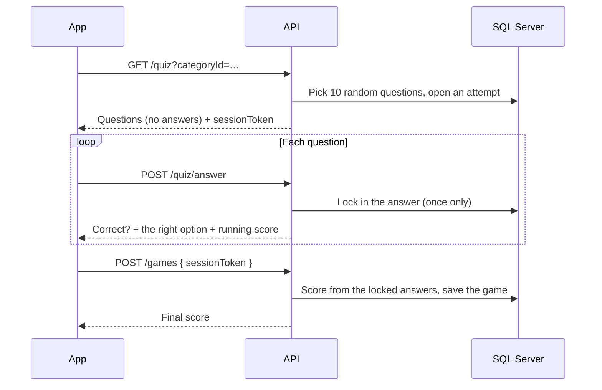

# Do You Know Ball? 💡

**Do you actually know ball, or do you just talk a lot?** Do You Know Ball? is a sports trivia app for iOS and Android. Pick a sport, pick a category, and answer 10 quick questions. You see right away whether each answer was right, and your best scores go on the leaderboard.

## Features

- **Two sports, five categories, 524 questions**
  - **Football:** History, Records & Stats, Players
  - **Soccer:** European Top 5 Leagues, Internationals
- **Instant feedback.** Every answer is checked by the server the moment you tap it.
- **Cheat-resistant scoring.** The phone never receives the answers. Scores are computed on the server from answers that are locked in as you play.
- **Accounts.** Sign up with an email and an Instagram-style username, then log in with either.
- **Profile and stats.** See your games played, accuracy, best round per sport, and recent games.
- **Leaderboards.** Each player's best score, ranked by sport.
- **Polished feel.** Animated splash screen, custom light-bulb branding, and playful motion throughout.

## Tech stack

| Layer | Technology |
|---|---|
| Mobile app | Flutter 3.38 (Dart), iOS + Android |
| App libraries | go_router (navigation), provider (state), dio (HTTP), flutter_secure_storage (tokens) |
| API | ASP.NET Core Web API on .NET 10 (C#), hosted on Azure App Service |
| Data access | Entity Framework Core with migrations |
| Database | SQL Server 2022 (Docker locally, Azure SQL in production) |
| Auth | JWT bearer tokens, ASP.NET Identity password hashing |
| Testing | xUnit + WebApplicationFactory (API), Flutter widget tests (app) |
| Design tooling | Python scripts that draw the logo and sport icons as SVG |

## System design



### How a round works



A few design choices behind this:

- **The server is the source of truth.** Correct answers stay in the database. Each answer can be submitted only once per question (a unique index enforces this), and an attempt can be submitted only once (a concurrency token enforces this), so replaying requests doesn't inflate a score.
- **Attempts expire.** A quiz has to be finished within an hour of being started.
- **Stateless auth.** The API issues a JWT at login. The app keeps it in the iOS Keychain or Android Keystore and restores the session on launch with `GET /me`.
- **Consistent errors.** Every error response has the same shape, `{ "error": "message" }`, so the app can show it directly.
- **Questions live in version control.** Trivia is stored as JSON under `seed/`, checked by a validator, and synced into the database by an idempotent loader. Questions added, edited or deleted in the files are reflected on the next run.

## Project structure

```
dykb/
├── mobile/            Flutter app
│   ├── lib/
│   │   ├── api/       API client and models
│   │   ├── auth/      Session, username and password rules
│   │   ├── screens/   Splash, welcome, auth, home, categories, profile…
│   │   └── widgets/   Shared UI (buttons, cards, header, nav bar…)
│   └── test/          Widget and client tests
├── api/
│   ├── Dykb.Api/      Controllers, services, EF models, migrations
│   └── Dykb.Api.Tests/ Integration tests
├── seed/              Trivia questions (JSON), schema and validator
├── design/            Logo and icon generators
└── docker-compose.yml Local SQL Server
```

## Running it locally

### Prerequisites

- [Docker Desktop](https://www.docker.com/products/docker-desktop/). On Apple Silicon, turn on **Settings › General › Use Rosetta for x86_64/amd64 emulation**, because SQL Server only ships an x86 image.
- [.NET 10 SDK](https://dotnet.microsoft.com/download)
- [Flutter 3.38+](https://docs.flutter.dev/get-started/install), plus Xcode (iOS) and/or the Android SDK (Android)

### 1. Start the database

Create a `.env` file in the repo root (it's git-ignored) with a strong password, then start SQL Server:

```bash
echo "MSSQL_SA_PASSWORD=<8+ chars with upper, lower, digit and symbol>" > .env
docker compose up -d
docker compose ps        # wait until it says "healthy"
```

### 2. Start the API

Store the dev secrets outside the repo (one-time setup):

```bash
cd api/Dykb.Api
dotnet user-secrets set "Jwt:Key" "$(openssl rand -base64 48)"
dotnet user-secrets set "ConnectionStrings:Default" \
  "Server=localhost,1433;Database=Dykb;User Id=sa;Password=<your MSSQL_SA_PASSWORD>;TrustServerCertificate=True"
```

Then run it:

```bash
dotnet run
```

In development, the API creates the tables and loads all the questions automatically on startup. It listens on **http://localhost:5050**. Port 5000 is avoided because macOS AirPlay uses it.

- Swagger UI: http://localhost:5050/swagger
- Health check: http://localhost:5050/health

### 3. Run the app

```bash
cd mobile
flutter pub get
open -a Simulator        # or start an Android emulator
flutter run
```

The iOS simulator reaches the API at `localhost:5050` and the Android emulator at `10.0.2.2:5050`. Both work without any setup. To use a real phone on the same Wi-Fi network, pass your computer's IP address:

```bash
flutter run --dart-define=API_BASE_URL=http://<your-computer-ip>:5050
```

## Deployment

The API runs on **Azure App Service** with an **Azure SQL** database, both on free tiers. Release builds of the app point at it automatically.

- Live API: https://dykb-api-csbb.azurewebsites.net/health
- To redeploy after changes: `az login`, then `sh infra/deploy.sh` (add `--seed` when there are new migrations or questions)
- Full setup, limits and commands: [infra/deploy.md](infra/deploy.md)

To play against the live API from a simulator:

```bash
cd mobile
flutter run --dart-define=API_BASE_URL=https://dykb-api-csbb.azurewebsites.net
```

## Running the tests

Neither test suite needs Docker or a running server.

```bash
cd api && dotnet test        # API integration tests (in-memory database)
cd mobile && flutter test    # widget and API-client tests
python3 seed/validate.py     # checks every question file
```

## API at a glance

| Endpoint | Auth | What it does |
|---|---|---|
| `POST /auth/register` | — | Create an account |
| `POST /auth/login` | — | Log in with email or username |
| `GET /me` | JWT | The signed-in account |
| `GET /sports` | JWT | All sports |
| `GET /sports/{id}/categories` | JWT | Categories for a sport |
| `GET /quiz?categoryId=` | JWT | Start a round of 10 questions |
| `POST /quiz/answer` | JWT | Lock in an answer and get feedback |
| `POST /games` | JWT | Finish the round and save the score |
| `GET /games/history` | JWT | Your recent games |
| `GET /leaderboard?sportId=` | JWT | Top players in a sport |
| `GET /health` | — | Liveness check |

Full request and response details are in Swagger while the API is running.

## Regenerating the logo and icons

The logo and sport icons are drawn in code under `design/`. After changing them:

```bash
sh design/render_assets.sh                # SVG → PNG (needs Google Chrome)
cd mobile
dart run flutter_launcher_icons           # app icons
dart run flutter_native_splash:create     # launch screen
```
